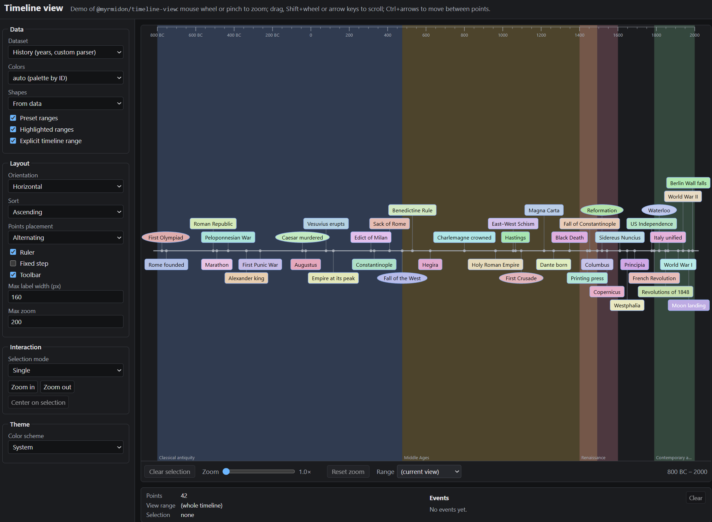

# NgxTimeline

This project was generated using [Angular CLI](https://github.com/angular/angular-cli) version 22.3.0.

An interactive, SVG-based timeline view for Angular 22+: zoneless, signal-based, themeable and accessible. This is a general-purpose component, even though its primary use was designed for the Cadmus editor.

- 📦 NPM: `@myrmidon/timeline-view`



Publish:

```sh
cd ./dist/myrmidon/timeline-view
npm publish --access=public
```
